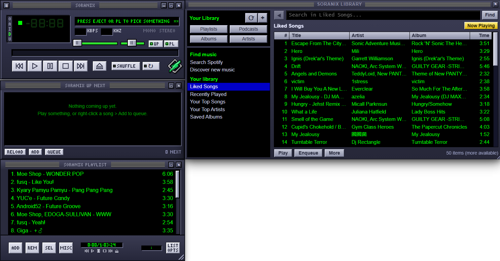
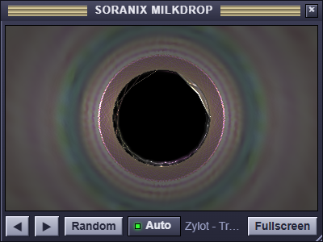

# Soranix

**A classic-style desktop music player for Spotify Premium on Windows, now also on Mac and Linux (test builds).**
Skinned, dockable windows, a real playlist editor, MilkDrop-style visuals, and a design built around one goal: use as few Spotify requests as possible, so you don't hit Spotify's cooldowns.



<p align="center"></p>

> Unofficial, fan-made project. Not made, endorsed or supported by Spotify. "Spotify" is a trademark of Spotify AB.

## Download

Everything is on the [Releases page](../../releases/latest).

| System | File |
|---|---|
| Windows | `Soranix-<version>.msi` |
| Mac with Apple Silicon (M1 or newer) | `Soranix-<version>-arm64.dmg` |
| Mac with Intel | `Soranix-<version>-x64.dmg` |
| Ubuntu / Debian / Mint | `soranix_<version>_amd64.deb` |
| Other Linux (x64) | `Soranix-<version>-x86_64.AppImage` |

### Windows

Download the `.msi` and run it.

- Installs for your Windows user only (no administrator rights) into `%LOCALAPPDATA%\Programs\Soranix`, with Start menu and Desktop shortcuts.
- The MSI isn't code-signed, so SmartScreen may say "Unknown publisher" the first time: **More info > Run anyway**.
- A newer MSI upgrades the installed copy. Uninstalling keeps your login and settings (`%APPDATA%\Soranix`).
- **Updates:** from version 1.0.327 on, Soranix checks this repo's Releases twice a day and **asks before installing** anything. When you press **Install**, it downloads the new MSI, checks its SHA-256 fingerprint against the one published with the release, then closes, updates and starts again. **Settings > Check for updates** checks right away.

### Mac (test build)

1. Open the `.dmg` and drag **Soranix** to **Applications**.
2. The app isn't signed by Apple yet, so run this once in Terminal:
   ```
   xattr -cr /Applications/Soranix.app
   ```
3. MilkDrop asks for **Screen Recording** permission, which it needs to hear the music.

> [!WARNING]
> Spotify doesn't play in the Mac build yet. It still needs the castLabs VMP signature.

### Linux (test build)

- **.deb** (Ubuntu, Debian, Mint): install it with
  ```
  sudo apt install ./soranix_<version>_amd64.deb
  ```
  then open Soranix from your app menu.
- **AppImage** (other distributions): make it executable and run it. On Ubuntu 24.04 or newer it may need `--no-sandbox`:
  ```
  chmod +x Soranix-<version>-x86_64.AppImage
  ./Soranix-<version>-x86_64.AppImage --no-sandbox
  ```
- On Wayland desktops Soranix runs through XWayland, because its see-through windows need X11.

### Not on Mac and Linux yet

- Balance
- Automatic updates (download new versions from the Releases page)
- Taskbar preview buttons

Media keys and the system's now-playing controls work on all three.

## One-time setup (about 3 minutes)

Soranix talks to Spotify through **your own** free Spotify developer app:

1. Go to <https://developer.spotify.com/dashboard>, log in and click **Create app**.
   - Name and description: anything you like.
   - **Redirect URI**: `http://127.0.0.1:8888/` (exactly like this), then **Add**.
   - Tick **Web API** and **Web Playback SDK**, then save.
2. Open the app's **Settings** and copy the **Client ID**.
3. Start Soranix, paste the Client ID in the library window and click **Connect**. You log in on Spotify's own page; Soranix never sees your password.
4. Getting a "403" error? In the dashboard, open **User Management** and add the email of the Spotify account you log in with.

Needs **Spotify Premium** (Spotify's rule for playback in third-party apps).

## Features

**Player and windows**
- Main window with 7-segment time, scrolling title, visualizer, volume, balance, seek and the classic transport buttons.
- Windows snap and dock together, can be resized, rolled up (double-click a title bar) and moved across monitors.
- Sizes: Normal, Medium, Large. Optional **Always on top**.
- Clicks pass through empty space to the apps behind it.

**Your music**
- **Library**: Liked Songs, Recently Played, Top Songs and Top Artists, Saved Albums, followed artists, podcasts, and all your playlists.
- **Search**: Spotify-wide search. With Liked Songs or a playlist open, the search box searches inside that list instead.
- **Playlist editor** and **Spotify playlists you made**: drag songs to reorder (saved to Spotify), add and remove songs, create, rename and delete playlists.
- **Up Next** and **Queue** windows show what plays next and the songs you queued.
- **Similar music after a search**: play a song from Search and a mix of related artists follows it instead of the other search results. Artists are spaced apart, karaoke and instrumental versions are left out, a few of your liked songs are mixed in, recently played songs aren't repeated, and skipping an artist early plays less of them.
- **Artist window**: bio and links (MusicBrainz, Wikipedia), discography, follow and unfollow.
- **Song info**, synced **lyrics** (LRCLIB) and a **MilkDrop** visualizer (Butterchurn) that reacts to your PC's sound.

**Windows integration**
- Song, artist and cover in Windows' media flyout and lock screen. Its buttons and your keyboard's media keys control Soranix.
- Previous, Play, Pause, Stop and Next buttons in the taskbar preview.
- Shows in the taskbar and Alt-Tab like any app.

## Keyboard shortcuts

| Action | Keys |
|---|---|
| Play / pause | `Space` |
| Next / previous track | `Ctrl + →` / `Ctrl + ←` |
| Shuffle / repeat | `Ctrl + S` / `Ctrl + R` |
| Volume up / down | `Ctrl + ↑` / `Ctrl + ↓` (or `↑` / `↓`) |
| Mute / unmute | `Ctrl + Shift + ↓` |
| Seek 5 seconds | `←` / `→` |
| Search Spotify | `Ctrl + K` or `Ctrl + L` |
| Search inside the open playlist or Liked Songs | `Ctrl + F` |
| Create a new playlist | `Ctrl + N` |
| Back / forward in the library | `Alt + ←` / `Alt + →` |
| Settings | `Ctrl + P` |
| Classic keys | `Z` previous, `X` play, `C` pause, `V` stop, `B` next, `S` shuffle, `R` repeat, `L` library |

While you're typing in a box (search, a playlist name, a dialog), keys go to the box. The only exceptions are `Ctrl + K`, `Ctrl + L` and `Ctrl + F`, which just move you to the search box.

## Built to avoid Spotify's cooldowns

Spotify apps in developer mode get blocked for an hour or more when they ask too often. Soranix is designed to ask as rarely as possible:

- **Saved copies on your PC.** Playlists are saved together with Spotify's version stamp, so a playlist only downloads again when it actually changed. Albums, artists, search results, top lists and song details are saved too, each for as long as it makes sense.
- **One request line.** Requests go out a few at a time with small gaps. Big jobs run slowest. When Spotify asks to wait, Soranix waits exactly as long as Spotify says (the `Retry-After` header) and pauses only that kind of request.
- **Safe limits.** Kinds of request that Spotify blocks for long periods are counted. Past a safe number per half hour, Soranix uses its saved copy or another route (Search) before Spotify would block.
- **No wasted requests.** Up Next is worked out locally. The playlist list refreshes every 30 minutes, checks its first page before fetching the rest, and pauses while you're away. Your own changes update the saved copies directly instead of downloading again.
- **Still usable during a block.** Saved playlists, albums and artists keep opening while Spotify makes you wait.

Saved copies take very little space (well under 1 MB for a typical library). Anything unused for 60 days is cleaned up automatically, and **Settings > Clear cache** empties it all.

## Spotify's limits (not bugs)

- **Playlists by other people:** since February 2026, Spotify only lets apps list the songs of playlists you made or collaborate on. Other playlists still play with **Play**.
- **Search results:** 10 per page; **More** loads the next page.
- **Accounts:** development-mode Spotify apps work for the owner plus up to 5 users added in User Management.
- **Genres:** Spotify no longer gives apps genres or related artists, so the similar-music mix gets related artists from Deezer's free public API (only the artist's name is sent).

## Privacy

- Your login and settings stay on your PC (`%APPDATA%\Soranix`). There's no Soranix server.
- The visualizers analyse your PC's sound output locally. Nothing is recorded or sent anywhere.
- Outside Spotify, Soranix only contacts public music databases: LRCLIB (lyrics), MusicBrainz and Wikipedia (artist info) and Deezer (related artists). It sends them song or artist names only.

## Building from source

Needs Node.js, plus a [castLabs EVS](https://github.com/castlabs/electron-releases/wiki/EVS) account to VMP-sign the app (Spotify's DRM refuses to play in unsigned builds).

```powershell
npm install
node build.js                                                      # release\Soranix\Soranix.exe
powershell -ExecutionPolicy Bypass -File installer\build-msi.ps1   # dist\Soranix-<version>.msi (needs WiX 3 in tools\wix3)
```

- `npm start` runs the app straight from the source folder.
- `powershell -ExecutionPolicy Bypass -File publish.ps1 -NotesFile notes.md` publishes a release in one step. It raises the version, builds the exe and MSI, writes the MSI's `.sha256` fingerprint, pushes, and creates the GitHub release that installed copies update from.
- Set `SORANIX_DEBUG=1` to open remote debugging on port 9229.

**Mac and Linux:** GitHub Actions builds them (Actions > **Build Mac & Linux** > Run workflow). Tick **Also publish a GitHub Release** to add the `.dmg`, `.deb` and AppImage files to this version's release. For Spotify to play on Mac, add the castLabs EVS account as the repository secrets `EVS_ACCOUNT_NAME` and `EVS_PASSWD`. On a Mac or Linux machine you can also build locally:

```bash
npm ci
npx electron-builder@26.18.0 --mac     # or --linux; files land in dist/
```

**Project layout**

| Path | What it is |
|---|---|
| `main.js` | Electron main process: windows, the built-in local server on `127.0.0.1:8888`, taskbar buttons |
| `preload.js` | The bridge between the page and Windows |
| `app.js` | The player: Spotify login (PKCE), playback, library, request queue, saved copies |
| `index.html`, `style.css` | Windows and theme |
| `helpers/balance.cs` | The small Windows helper for left/right balance |
| `installer/` | WiX installer definition and build script |
| `electron-builder.yml`, `scripts/vmp-sign.js` | Mac and Linux packaging, and castLabs signing for Mac |
| `.github/workflows/build-mac-linux.yml` | The GitHub Actions build for Mac and Linux |
| `icons/` | App icons and the scripts that make them |

## Credits

Electron ([castLabs build with Widevine](https://github.com/castlabs/electron-releases), MIT), [Butterchurn](https://github.com/jberg/butterchurn) and Butterchurn presets (MIT), [LRCLIB](https://lrclib.net), [MusicBrainz](https://musicbrainz.org), Wikipedia, Deezer API.

This software is provided "as is", without warranty of any kind.
